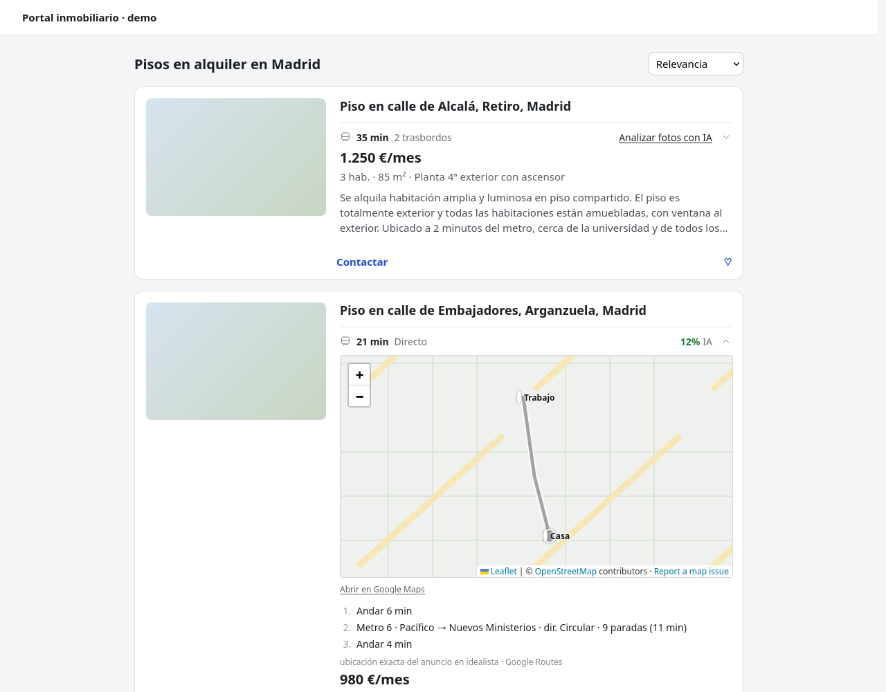
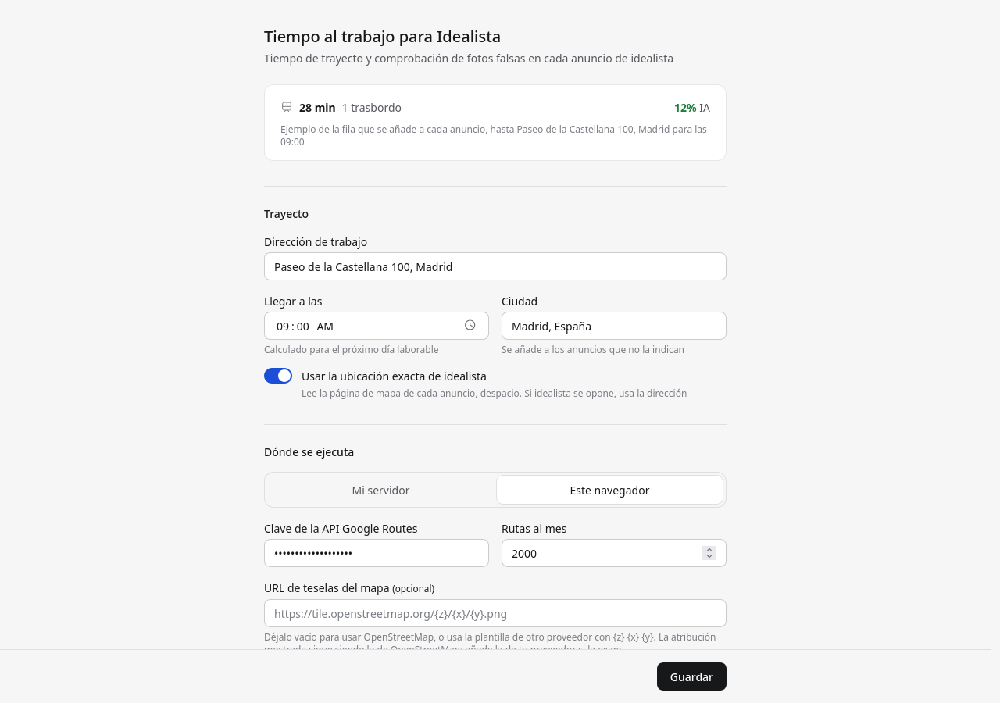
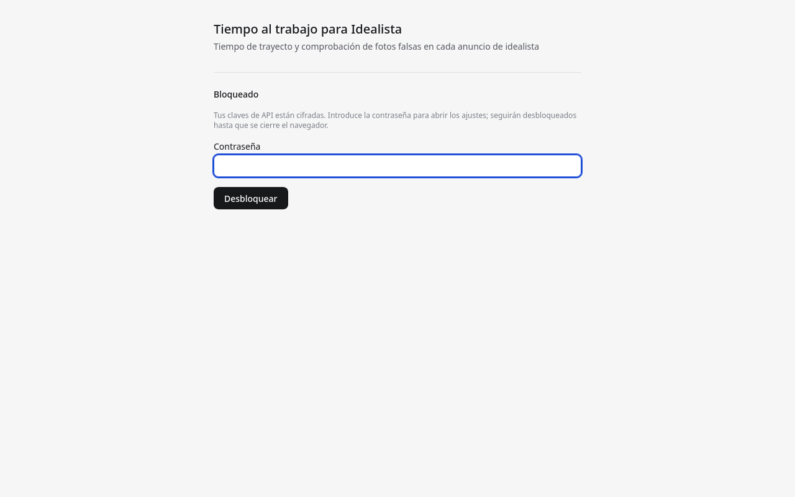
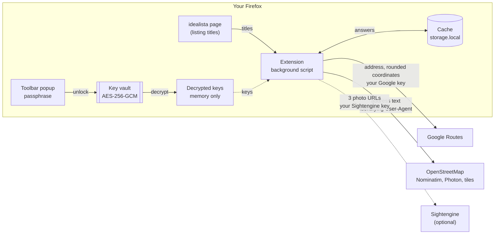
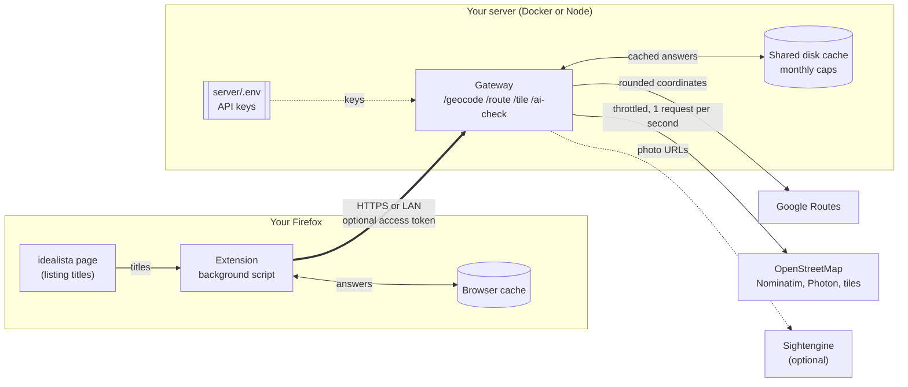

<div align="center">


# Commute Time for Idealista

**See how long every idealista listing is from your work, by public transport, without leaving the results page.**

Spanish by default, English when your browser is in English.

Firefox extension · two ways to run it: **with your own API keys in the browser**, or **through a server you host yourself**


</div>

---

## What you get

- **A commute line on every listing**: `28 min · 1 change ▾`. Click it for an **interactive map** (drag, zoom, scroll)
  with home, work and the route, the numbered steps, and an *Open in Google Maps* link.
- **Sort by commute time**: an entry is added to idealista's own *Ordenar* list. Only listings without a result yet
  are computed; the rest come from cache.
- **The exact pin**: the extension reads the listing's own map page (`/inmueble/<id>/mapa`) instead of guessing from
  the title, which avoids street-name mix-ups. If idealista objects it falls back to the address.
- **Fake-photo check** (optional): one click on a listing scans up to **3 random photos** with
  [Sightengine](https://sightengine.com)'s AI-image detector and shows the % chance each is AI-generated, so you can
  spot a fake advertisement. Every scanned photo is cached, so it is never scanned twice.
- **Cheap by design**: every answer is cached and a monthly limit caps the paid calls.
- **Spanish by default**, English when your browser is in English.

> Spain-focused: geocoding is restricted to Spain and the defaults assume Madrid (city suffix, map bias).
> Change the *City* option for another Spanish city.

## Two ways to run it

You pick one in the options (*Where it runs*). The fake-photo check has its own choice of the same two.

| | **A. API keys in the browser** | **B. Your own server** |
|---|---|---|
| Set-up | Paste your Google Routes key (and optionally a Sightengine key) in the options | Run the included server (Docker or Node), paste its address in the options |
| Needs | A Google Cloud key, nothing else | A machine that stays on (laptop, Raspberry Pi, VPS) and a Google key in the server's `.env` |
| Where the keys live | In your browser, **encrypted with a passphrase** you choose ([details](#your-keys)) | On the server only; the browser never sees them |
| Who calls Google / OpenStreetMap / Sightengine | Your browser, directly | The server, on the browser's behalf |
| Cache and monthly limit | Per browser | Shared by everyone using the server, enforced server-side |
| Sharing with friends | Each person needs their own key | They just type your server's address (optionally an access token) |
| Best for | Just you, fastest to start | A household or a group, or if you don't want keys in the browser |

Both modes show the same thing on the page and use the same cache rules. You can mix them: for example commute through
your server and the photo check with your own Sightengine key.

## Screenshots

<p align="center">
  
</p>

| Options | English | Locked keys |
|---|---|---|
|  |  |  |

(Demo data, generated with `tools/screenshots/`.)

## How it works

### A. API keys in the browser

Everything runs inside Firefox. The keys sit encrypted on disk and are decrypted into memory only after you unlock.



### B. Your own server

The extension only knows your server's address. The server holds the keys, shares one cache and enforces the limits.



In both modes the page itself is only read for listing titles, the listing's own map page and its photo addresses. Nothing
on your idealista session is sent anywhere.

## Install the extension

- **Signed build (permanent):** download the `.xpi` from the
  [latest release](https://github.com/SelfishCoconut/idealista-commute/releases/latest), then in Firefox open
  `about:addons` → gear icon → *Install Add-on From File…*.
- **Temporary (testing):** Firefox → `about:debugging#/runtime/this-firefox` → *Load Temporary Add-on* → pick
  `manifest.json` in this folder.
- **Your own signed build:** see [Packaging](#packaging).

Requires **Firefox 140+**.

## Set-up A: API keys in the browser

1. In the extension options, set your **work address** and **arrive-by** time.
2. Under *Where it runs* choose **This browser** and paste your **Google Routes API key**.
3. Choose a **passphrase** (8+ characters) and press **Save**. The keys are stored encrypted; you unlock them once per
   browser session from the toolbar icon (a red `!` shows while locked).
4. Reload your idealista tab.

<details>
<summary><b>Getting a Google key</b></summary>

In [Google Cloud Console](https://console.cloud.google.com/): create a project → enable billing → enable the
**Routes API** → create an API key and **restrict it to the Routes API**. Google's free monthly allowance is generous
for personal use, and the *Routes per month* option makes the extension refuse any call beyond your limit.
</details>

For the fake-photo check, create a free [Sightengine](https://sightengine.com) account and choose **My Sightengine
key** under *Fake-photo check*. Firefox asks once for permission to reach each service when you save.

## Set-up B: your own server

You need **Docker** (or Node 22) and a **Google Cloud API key** for the Routes API (or your own
[router](#use-a-different-routing-engine)).

```bash
git clone https://github.com/SelfishCoconut/idealista-commute.git
cd idealista-commute/server
cp .env.example .env && chmod 600 .env     # put your key in GOOGLE_API_KEY=
./start.sh                                 # LAN-reachable on port 8085 (BIND=127.0.0.1 ./start.sh for local only)
```

`start.sh` prints the URL to use. `./stop.sh` stops it; the container restarts after reboots. Then in the extension
options choose **My server**, set your work address, paste the server URL (empty = this machine), press **Test server**
and **Save**, and reload your idealista tab. For the photo check on the server, set `SIGHTENGINE_USER` and
`SIGHTENGINE_SECRET` in `server/.env`.

<details>
<summary><b>Without Docker</b></summary>

```bash
GOOGLE_API_KEY=… CACHE_FILE=./cache/cache.jsonl TILE_DIR=./cache/tiles node server/gateway/gateway.mjs
```
No dependencies; Node 22+. Everything is configured through environment variables (see
[`server/.env.example`](server/.env.example)).
</details>

## Your keys

If you use *This browser* mode or your own Sightengine key, the API keys are encrypted with a passphrase you choose
(AES-256-GCM, key derived with PBKDF2, 600 000 rounds). Only ciphertext is written to disk; the decrypted keys live in
memory until the browser closes. When they are locked, the toolbar icon shows a red `!`, opens an unlock popup (and
tries to open it when you load idealista), and the options page shows only an unlock form. Forget the passphrase and
you simply re-enter the keys. With a server, the keys stay in the server's `.env` and none of this applies.

## Sharing a server

The server (mode B) runs anywhere Node or Docker does: a laptop, a Raspberry Pi, a VPS.

| Setup | Server URL in the extension |
|---|---|
| Same machine | *(leave empty)*, defaults to `http://127.0.0.1:8085` |
| Another machine on your network | its IP, e.g. `192.168.1.50` (port 8085 is assumed) |
| Behind a reverse proxy with HTTPS | `https://commute.example.org` |

Friends can use *your* server: they install the extension, type its address in **Server URL**, **Test server**,
**Save**. Tip: give the server a fixed address (DHCP reservation) so the URL doesn't change.

> **Security:** by default the server has no authentication, so anyone who can reach it can spend your quota (bounded
> by the monthly cap, which also holds under parallel requests). Set `ACCESS_TOKEN` in `server/.env` to require a
> shared secret (users enter it under *Access token* in the options), run with `BIND=127.0.0.1` if only this machine
> needs it, and never expose port 8085 directly to the internet. `/route` only accepts JSON, so other websites
> can't trigger paid calls through a visitor's browser. The API key lives only in `server/.env` and is never sent to
> browsers.

### What is cached

| What | Where | For how long |
|---|---|---|
| Routes (start/end rounded to ~11 m + arrive-by) | server | 7 days (no-route: 1 day) |
| Geocoding | server | 90 days (misses: 1 day) |
| AI-photo scores (per photo URL) | server | 30 days |
| Map tiles | server disk | 14 days |
| All of the above + commute results | browser | 14 days (results: 12 h) |

Trips are always planned for the *next Wednesday* at your arrive-by time (a representative weekday), so one answer
is reused all week. Check usage at `http://<server>:8085/health`.

## Use a different routing engine

The extension only needs the [backend contract](docs/backend-api.md), and the server makes the router pluggable:

```bash
# server/.env
ROUTER_MODULE=/routers/my-router.mjs
```

```js
// server/routers/my-router.mjs
export default async function route({ from, to, arriveBy }) {
  // call OpenTripPlanner, Transitous, HERE, TravelTime, your own thing…
  return { found: true, minutes: 27, transfers: 1, provider: 'My router',
           steps: [{ mode: 'walk', minutes: 4, text: 'Walk 4 min' } /* , … */] };
}
```

[`server/routers/example-router.mjs`](server/routers/example-router.mjs) is a runnable, commented template.
Caching, the monthly cap, geocoding and tiles keep working with any router. Prefer to replace the whole server?
Implement the four endpoints in [`docs/backend-api.md`](docs/backend-api.md) in any language and put its address in
**Server URL**.

## Privacy

- The extension reads listing titles (and the listing's own `/mapa` page, slowly, one at a time, like opening it
  yourself) on idealista pages **you** open.
- **Mode A (API keys):** your browser sends your **work address** and each listing's **location text** to OpenStreetMap
  (Nominatim, then Photon) and **rounded coordinates** to Google Routes with your key; map tiles come straight from
  OpenStreetMap, with a `User-Agent` that identifies this app as their policies require (the tile URL is configurable).
- **Mode B (server):** the same data goes only to your server, which talks to those services for you.
- **Photo check:** the addresses of up to three listing photos go to Sightengine, from your browser (your key) or via
  your server.
- No analytics, no accounts. Settings and caches stay in your browser's extension storage. See [PRIVACY.md](PRIVACY.md).

## Repository layout

```
manifest.json, background.js        extension core (settings, caching, throttling)
content.js / content.css            what appears on idealista (commute line, sort entry, map)
options.html / options.js           settings page
lib/backend.js, lib/direct.js       network clients: your server, or Google Routes/OpenStreetMap straight from the browser
lib/vault.js, popup.*               encrypted key storage and the unlock popup
icons/                              logo (icon.svg is the source of the PNGs)
lib/idealista.js, address.js, …     page parsing, address clean-up, map drawing, helpers
lib/vendor/leaflet/                 Leaflet (BSD-2-Clause) for the interactive map
server/gateway/                     reference backend: gateway.mjs (HTTP, cache, caps), google.mjs (Google Routes)
server/routers/                     custom router template
server/compose.yaml, start.sh       Docker deployment
docs/backend-api.md                 the HTTP contract
test/, server/gateway/*.test.mjs    unit tests (npm test)
```

## Development

```bash
npm test          # node's built-in test runner, no install needed
npm run lint      # web-ext lint (needs: npx web-ext)
npm run server    # run the backend directly with Node
```

### Packaging

```bash
npx web-ext build                                   # unsigned zip in web-ext-artifacts/
npx web-ext sign --channel=unlisted \               # signed .xpi installable in release Firefox
  --api-key=$AMO_JWT_ISSUER --api-secret=$AMO_JWT_SECRET
```
Get the API credentials at <https://addons.mozilla.org/developers/addon/api/key/>. Keep them out of the repo.

## Known limitations

- **Written without access to the live idealista site**, which blocks non-browser clients. The listing selectors,
  the *Ordenar* menu hook and the `/mapa` parser are tolerant and were exercised against local copies of the markup,
  not the real pages. If something doesn't show, open an issue with the browser console output; a saved copy of a listing's `/mapa` page makes a perfect test fixture.
- Sorting covers the results on the current page only; idealista paginates on its server.
- Spain only (geocoding is restricted to it).

## License

[Beerware](LICENSE) (Revision 42): do whatever you want with it, keep the notice, and if we meet and you think it's
worth it, buy me a beer. Leaflet is © Vladimir Agafonkin, BSD-2-Clause (see `lib/vendor/leaflet/LICENSE`). Map data ©
OpenStreetMap contributors. Not affiliated with idealista, Google or Sightengine.
