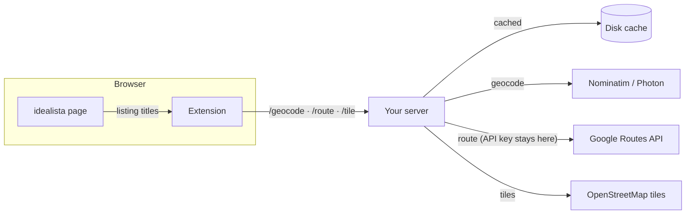

<div align="center">

# 🚇 Idealista Commute

**See how long every idealista listing is from your work, by public transport, without leaving the results page.**

Firefox extension · self-hostable backend · your API key never leaves your server


</div>

---

## What you get

- **A commute line on every listing**: `🚇 28 min · 1 change ▾`. Click it for an **interactive map** (drag, zoom, scroll)
  with home, work and the route, the numbered steps, and an *Open in Google Maps* link.
- **Sort by commute time**: a *Tiempo al trabajo* entry is added to idealista's own *Ordenar* list. Only listings
  without a result yet are computed; the rest come from cache.
- **The exact pin**: the extension reads the listing's own map page (`/inmueble/<id>/mapa`) instead of guessing from
  the title, which avoids street-name mix-ups. If idealista objects it falls back to the address.
- **Fake-photo check**: on a listing page, one click scans up to **3 random photos** with
  [Sightengine](https://sightengine.com)'s AI-image detector and shows the % chance each one is AI-generated, so you
  can spot a fake advertisement. Optional, needs a free Sightengine account, and works two ways: put the credentials in
  `server/.env` (`SIGHTENGINE_USER`/`SIGHTENGINE_SECRET`: key stays on the server, shared cache and cap), or type them into
  the extension options (the browser calls Sightengine directly, no server needed; the secret is stored in plain text in
  your browser profile). Credentials in the options win. Every scanned photo is cached, so it is never scanned twice.
- **Cheap by design**: every answer is cached, in your browser and on your server, so the same trip is never paid
  for twice, and the server enforces a hard monthly cap on paid calls.
- **Your backend, your rules**: the extension talks to *one* server through a [small HTTP contract](docs/backend-api.md).
  Run the included one (Docker or plain Node), or point it at any server you like.

> Spain-focused: geocoding is restricted to Spain and the defaults assume Madrid (city suffix, map bias).
> Change the *City suffix* option for another Spanish city.

## How it works



The extension never calls Google (or anyone else) directly: it only knows your server's URL. The server holds the
API key, caches everything, throttles the public OpenStreetMap services politely, and caps paid calls.

## Quick start

You need **Firefox 140+**, **Docker** (or Node 22) and a **Google Cloud API key** for the Routes API
(or your own [router](#use-a-different-routing-engine)).

### 1. Run the server

```bash
git clone https://github.com/SelfishCoconut/idealista-commute.git
cd idealista-commute/server
cp .env.example .env && chmod 600 .env     # put your key in GOOGLE_API_KEY=
./start.sh                                 # LAN-reachable on port 8085 (BIND=127.0.0.1 ./start.sh for local only)
```

`start.sh` prints the URL to use. `./stop.sh` stops it; the container restarts after reboots.

<details>
<summary><b>Getting a Google key</b></summary>

In [Google Cloud Console](https://console.cloud.google.com/): create a project → enable billing → enable the
**Routes API** → create an API key and **restrict it to the Routes API**. Google's free monthly allowance is
generous for personal use, and `GOOGLE_MONTHLY_LIMIT` (default 2000) makes the server refuse any call beyond it.
</details>

<details>
<summary><b>Without Docker</b></summary>

```bash
GOOGLE_API_KEY=… CACHE_FILE=./cache/cache.jsonl TILE_DIR=./cache/tiles node server/gateway/gateway.mjs
```
No dependencies; Node 22+. Everything is configured through environment variables (see
[`server/.env.example`](server/.env.example)).
</details>

### 2. Install the extension

- **Temporary (testing):** Firefox → `about:debugging#/runtime/this-firefox` → *Load Temporary Add-on* → pick
  `manifest.json` in this folder.
- **Permanent:** use a signed build: see [Packaging](#packaging).

### 3. Configure

Open the extension's options, set your **work address** and **arrive-by** time, press **Test server** and **Save**.
Reload your idealista tab.

## Self-hosting and sharing

The server runs anywhere Node or Docker does: a laptop, a Raspberry Pi, a VPS.

| Setup | Server URL in the extension |
|---|---|
| Same machine | *(leave empty)*, defaults to `http://127.0.0.1:8085` |
| Another machine on your network | its IP, e.g. `192.168.1.50` (port 8085 is assumed) |
| Behind a reverse proxy with HTTPS | `https://commute.example.org` |

Friends can use *your* server: they install the extension, type its address in **Server URL**, **Test server**,
**Save**. Tip: give the server a fixed address (DHCP reservation) so the URL doesn't change.

> **Security:** by default the server has no authentication, so anyone who can reach it can spend your quota (bounded
> by the monthly cap, which also holds under parallel requests). Set `ACCESS_TOKEN` in `server/.env` to require a
> shared secret (users enter it under *Access token* in the options), run with `BIND=127.0.0.1` if only this machine
> needs it, and never expose port 8085 directly to the internet. `/route` only accepts JSON, so other websites
> can't trigger paid calls through a visitor's browser. The API key lives only in `server/.env` and is never sent to
> browsers.

### What is cached

| What | Where | For how long |
|---|---|---|
| Routes (start/end rounded to ~11 m + arrive-by) | server | 7 days (no-route: 1 day) |
| Geocoding | server | 90 days (misses: 1 day) |
| AI-photo scores (per photo URL) | server | 30 days |
| Map tiles | server disk | 14 days |
| All of the above + commute results | browser | 14 days (results: 12 h) |

Trips are always planned for the *next Wednesday* at your arrive-by time (a representative weekday), so one answer
is reused all week. Check usage at `http://<server>:8085/health`.

## Use a different routing engine

The extension only needs the [backend contract](docs/backend-api.md), and the server makes the router pluggable:

```bash
# server/.env
ROUTER_MODULE=/routers/my-router.mjs
```

```js
// server/routers/my-router.mjs
export default async function route({ from, to, arriveBy }) {
  // call OpenTripPlanner, Transitous, HERE, TravelTime, your own thing…
  return { found: true, minutes: 27, transfers: 1, provider: 'My router',
           steps: [{ mode: 'walk', minutes: 4, text: 'Walk 4 min' } /* , … */] };
}
```

[`server/routers/example-router.mjs`](server/routers/example-router.mjs) is a runnable, commented template.
Caching, the monthly cap, geocoding and tiles keep working with any router. Prefer to replace the whole server?
Implement the four endpoints in [`docs/backend-api.md`](docs/backend-api.md) in any language and put its address in
**Server URL**.

## Privacy

- The extension reads listing titles (and the listing's own `/mapa` page, slowly, one at a time, like opening it
  yourself) on idealista pages **you** open. Nothing is sent anywhere except your server.
- Your **work address** and each listing's **location text** go to your server, which geocodes them with the public
  OpenStreetMap services (Nominatim, then Photon). **Rounded coordinates** go to Google for routing. Tiles come from
  OpenStreetMap through your server.
- No analytics, no accounts. Settings and caches stay in your browser's extension storage.

## Repository layout

```
manifest.json, background.js        extension core (settings, caching, throttling)
content.js / content.css            what appears on idealista (commute line, sort entry, map)
options.html / options.js           settings page
lib/backend.js                      the extension's ONLY network client (talks to your server)
lib/idealista.js, address.js, …     page parsing, address clean-up, map drawing, helpers
lib/vendor/leaflet/                 Leaflet (BSD-2-Clause) for the interactive map
server/gateway/                     reference backend: gateway.mjs (HTTP, cache, caps), google.mjs (Google Routes)
server/routers/                     custom router template
server/compose.yaml, start.sh       Docker deployment
docs/backend-api.md                 the HTTP contract
test/, server/gateway/*.test.mjs    unit tests (npm test)
```

## Development

```bash
npm test          # node's built-in test runner, no install needed
npm run lint      # web-ext lint (needs: npx web-ext)
npm run server    # run the backend directly with Node
```

### Packaging

```bash
npx web-ext build                                   # unsigned zip in web-ext-artifacts/
npx web-ext sign --channel=unlisted \               # signed .xpi installable in release Firefox
  --api-key=$AMO_JWT_ISSUER --api-secret=$AMO_JWT_SECRET
```
Get the API credentials at <https://addons.mozilla.org/developers/addon/api/key/>. Keep them out of the repo.

## Known limitations

- **Written without access to the live idealista site**, which blocks non-browser clients. The listing selectors,
  the *Ordenar* menu hook and the `/mapa` parser are tolerant and were exercised against local copies of the markup,
  not the real pages. If something doesn't show, open an issue with the browser console output (turn on *Log raw
  route responses* in the options); a saved copy of a listing's `/mapa` page makes a perfect test fixture.
- Sorting covers the results on the current page only; idealista paginates on its server.
- Spain only (geocoding is restricted to it).

## License

[MIT](LICENSE). Leaflet is © Vladimir Agafonkin, BSD-2-Clause (see `lib/vendor/leaflet/LICENSE`). Map data ©
OpenStreetMap contributors. Not affiliated with idealista or Google.
